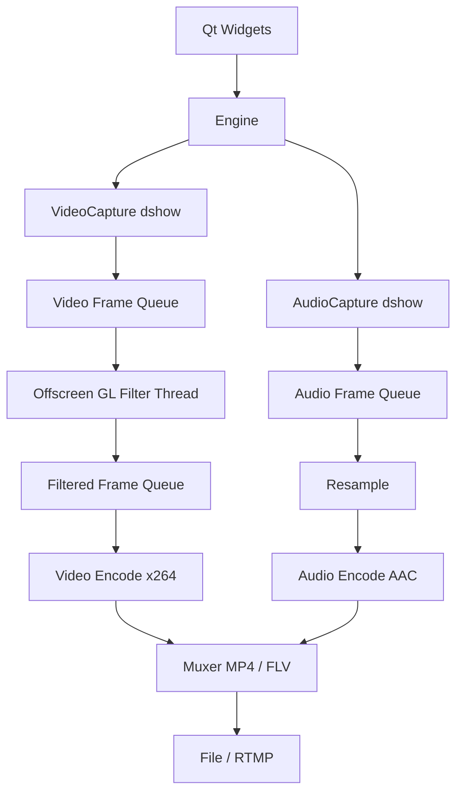

# OpenLiveStudio：GPU 实时录制/推流工具 — 项目方案

> 简历主项目方案：单源采集 + GPU 滤镜 + H.264/AAC + MP4/RTMP。原创设计，AI 辅助实现，参考现有项目但不复制代码。

## 0. 文档信息

| 项 | 内容 |
| --- | --- |
| 项目名 | OpenLiveStudio |
| 定位 | C++/Qt 音视频 + 图形方向的主项目 |
| 周期 | 5–6 周（AI 辅助；MVP 4–5 周 + V1 1–2 周） |
| 投入估算 | 每周 15–20 小时 |
| 平台 | Windows 10/11，MSVC 2022，Qt 6.5+，FFmpeg 6.x，OpenGL 3.3/4.1 |
| 输出 | MP4 录制；V1 加 RTMP 推流 |
| 参考 | `D:\Code\videoCapture`（架构思路）、`D:\Code\Qt-OpenCV-OpenGL-FFMPEG`（shader 思路） |

### 速览

- **做什么**：摄像头/麦克风采集 → GPU 滤镜 → H.264/AAC → MP4 录制；V1 加 RTMP 推流。
- **为什么**：一个项目同时覆盖音视频链路（采集/编码/封装/推流/时间戳）和图形链路（YUV/GLSL/FBO/PBO），比纯播放器或纯滤镜 demo 更能打。
- **最小可交付**：摄像头 + 麦克风、3 个 GPU 滤镜、1080p30、MP4 录制、音画同步、性能面板。
- **完整版**：加 RTMP、屏幕采集、硬件编码回退、第 4 个滤镜。
- **周期**：5–6 周（AI 辅助；4 周压缩 / 8 周稳妥）。
- **执行方式**：AI 辅助编码，你负责架构、review、调试与测试；关键模块必须能脱稿讲。

## 1. 项目定位

### 1.1 一句话

一个 Windows 桌面录制/推流工具：FFmpeg 负责采集、编码、封装与推流，OpenGL 负责 YUV 预览与 GPU 滤镜，Qt 负责界面与设备/参数控制。

### 1.2 为什么适合做主项目

- **音视频**：采集、时间戳、H.264/AAC、MP4/FLV、RTMP，都是音视频岗的高频考点；
- **图形**：YUV→RGB、GLSL、FBO ping-pong、PBO 回读，能证明 OpenGL 不是只会画三角形；
- **C++/Qt**：多线程、有界队列、背压、RAII、设备枚举、UI 状态管理；
- **可量化**：延迟、GPU 滤镜耗时、CPU 占用、丢帧率、音画漂移，都能写进简历；
- **原创**：单源、独立设计，不复制参考项目；AI 只做辅助编码。

### 1.3 与两个参考项目的边界

| 参考项目 | 借什么 | 不借什么 |
| --- | --- | --- |
| `videoCapture` | 线程/队列/时间戳/编码链路的**思路** | 多源合成、OBS UI、GPL 代码 |
| `Qt-OpenCV-OpenGL-FFMPEG` | YUV/GLSL/FBO 的**思路** | 摄像头 demo 架构、无许可证代码 |

两条原则：

1. **代码自己设计/审查**，不复制参考项目；AI 可辅助编码；README 注明参考来源。
2. **许可证先定**：自己的代码用 MIT；FFmpeg 动态链接 LGPL 构建；`libx264` 是 GPL，若链接它，整个作品分发时需按 GPL，或改用硬件编码/OpenH264。

### 1.4 与旧方案的关系

`docs/opengl-gpu-image-engine-plan.md` 是“项目 1：图像引擎”，适合投图像岗；本方案是主项目，覆盖音视频 + GPU，适合投音视频/客户端岗。两者可以共享 `FilterChain`/GL 封装，但主项目不依赖项目 1，建议先做本方案。

## 2. 范围

### 2.1 MVP（P0，4–5 周）

| ID | 功能 | 说明 | 验收 |
| --- | --- | --- | --- |
| F1 | 摄像头采集 | FFmpeg dshow，枚举设备，1080p30 | 画面正常、颜色正确 |
| F2 | 麦克风采集 | dshow，48kHz 双声道 | 录音有声音、无爆音 |
| F3 | 预览 | YUV→RGB shader，正确宽高比 | 30fps，延迟可接受 |
| F4 | GPU 滤镜链 | FBO ping-pong，可增删 Pass | 至少 3 个 Pass 串联 |
| F5 | 滤镜 | 调色、高斯/锐化、Sobel/暗角 | 参数实时、可 bypass |
| F6 | 视频编码 | libx264，YUV420P，1080p30 | 文件可播放 |
| F7 | 音频编码/封装 | AAC + MP4 | 音画都有、时长正确 |
| F8 | 录制控制 | 开始/停止、文件命名、错误提示 | 连续录 10 分钟不崩 |
| F9 | 音画同步 | 采集时间戳、统一起点、PTS | 10 分钟漂移 < 50ms |
| F10 | 统计/诊断 | FPS、GPU ms、码率、丢帧 | 数据可复现 |

### 2.2 V1（P1，2 周，选 2–3 个）

- RTMP 推流（FLV），断线重连；
- 屏幕采集（`gdigrab` 或 DXGI）；
- 硬件编码回退（NVENC / QSV / AMF → libx264）；
- 第 4 个滤镜（3D LUT / 暗角 / 颗粒）；
- 离屏预览共享纹理，替代 QImage 预览；
- 录制暂停/恢复、截图。

### 2.3 不做（P2）

- 多源叠加/移动/缩放/层级（这是 OBS 的复杂度，直接放弃）；
- 人脸检测、磨皮、美白；
- 播放器/seek/播放列表；
- 跨平台、4K60、音频混音。

## 3. 技术选型

| 组件 | 选择 | 理由 |
| --- | --- | --- |
| 语言 | C++17 | RAII、智能指针、移动语义 |
| UI | Qt 6 Widgets | 桌面工具，开发快 |
| 采集 | FFmpeg `avdevice`（dshow） | 设备枚举、格式协商、时间戳可控 |
| 编解码 | FFmpeg 6.x（avcodec/swscale/swresample） | 音视频岗标准技术栈 |
| 编码器 | libx264 + AAC；V1 硬件回退 | 先保证能跑，再谈性能 |
| 渲染/滤镜 | OpenGL 3.3/4.1 Core + GLSL | FBO、PBO、YUV shader |
| 构建 | CMake + MSVC 2022 | 比 qmake 更适合现代项目 |
| 测试 | CTest + ffprobe/ffplay | 输出可验证 |
| 依赖 | vcpkg 或预编译 FFmpeg | 不把 DLL 提交进仓库 |

### 3.1 为什么用 FFmpeg 采集，而不是 Qt QCamera

- 音视频岗关心的是 `avdevice`、`av_read_frame`、PTS、格式协商，Qt QCamera 把这些都藏起来了；
- 后续要接屏幕采集、RTMP、硬件编码，FFmpeg 是统一入口；
- Qt 只做 UI 和预览，职责更清楚。

### 3.2 为什么只做单源

多源合成会把项目变成“OBS 复刻”，工作量翻倍，而且和参考项目高度重叠。单源 + GPU 滤镜 + 编码/推流已经足够撑起一个主项目。

### 3.3 构建环境

- 用 **MSVC 2022** kit，不要 MinGW：FFmpeg 的 `.lib` 与 MSVC 匹配，MinGW 要改用 `.dll.a`，踩坑多；
- FFmpeg 用 shared 构建，运行时拷贝 DLL，不把 DLL 提交进仓库；
- CMake 里用 `FFMPEG_ROOT` 或 `find_package`，README 写清依赖版本；
- 先保证 Debug/Release 都能构建，再谈功能。

## 4. 架构

### 4.1 模块划分



| 模块 | 职责 |
| --- | --- |
| `ui` | 设备/格式/码率选择、滤镜滑杆、录制按钮、统计 |
| `capture` | dshow 枚举、打开、读包、解码、时间戳 |
| `gl` | 离屏上下文、Texture/FBO/Shader/PBO 的 RAII 封装 |
| `filters` | 调色、高斯、Sobel、LUT 等 |
| `encode` | 视频/音频编码器封装 |
| `mux` | MP4/FLV 封装、RTMP 输出 |
| `core` | Engine、队列、线程、统计、生命周期 |

### 4.2 数据流

```text
视频：dshow → decode → YUV420P → GPU(YUV→RGB→滤镜→RGB) → PBO 回读
      → sws_scale(RGBA→YUV420P) → x264 → MP4/FLV

音频：dshow → decode → swr_convert(48k/双声道/FLTP) → AAC → MP4/FLV
```

### 4.3 线程与队列

| 线程 | 职责 | 队列/策略 |
| --- | --- | --- |
| UI | 控件、预览 QImage、统计 | 预览可丢帧 |
| VideoCapture | dshow 读包/解码/打时间戳 | `videoRaw`，容量 3–5，满则丢旧 |
| AudioCapture | dshow 读包/解码 | `audioRaw`，容量 10–20，不丢 |
| GLFilter | 离屏 GL、滤镜、PBO 回读、RGBA→YUV | `videoFiltered`，容量 3，满则丢旧 |
| VideoEncode | x264 编码 | `videoPacket`，容量 10 |
| AudioEncode | AAC 编码 | `audioPacket`，容量 20 |
| Muxer | 按 DTS 交织、写文件/推流 | 不丢包，写失败即停 |

原则：

- 队列**有界**，避免内存无限增长；
- 视频可以丢帧，音频不丢；
- 丢帧要计数，写进统计；
- 停止时用空帧/标志位唤醒所有线程，编码器 `flush`，muxer 写 trailer。

### 4.4 为什么用离屏 GL

录制时窗口可能被遮挡/最小化，不能依赖 `QOpenGLWidget::paintGL` 驱动。用 `QOffscreenSurface` + `QOpenGLContext` 在独立线程做滤镜和回读：

- 录制不受窗口可见性影响；
- GL 调用都在同一线程，避免上下文错乱；
- 预览把结果降采样成 `QImage`（如 960×540）发回 UI，30fps 足够；
- V1 再考虑共享纹理，省掉预览回读。

如果第 2 周结束还没跑通离屏 GL：退回 GUI 线程 + `QOpenGLWidget`，先保 MVP；V1 再改。不要为了架构完美拖垮进度。

## 5. 关键设计

### 5.1 采集

- `avdevice_register_all()`、`av_find_input_format("dshow")`；
- `avdevice_list_input_sources()` 枚举摄像头/麦克风，UI 里显示名称；
- 打开参数：`video_size`、`framerate`、`rtbufsize`；
- 摄像头常见 MJPEG/YUY2，需要解码/转换到 YUV420P；
- `av_read_frame` → `avcodec_send_packet` → `avcodec_receive_frame`；
- PTS 优先级：设备 PTS > 采集墙钟；没有 PTS 时用 `av_gettime_relative()` 打时间戳。

### 5.2 GPU 滤镜

- Y/U/V 三张纹理上传（`GL_R8` / `GL_RED`），fragment shader 做 BT.709 limited range → RGB；
- 中间 FBO 用 `RGBA16F`，最终输出 `RGBA8`；
- FBO ping-pong，`Filter` 接口统一 `apply(src, dst, params)`；
- 首批滤镜：
  1. 调色：曝光/对比度/饱和度；
  2. 可分离高斯：H/V 两 Pass；
  3. Sobel 边缘或暗角（二选一）。
- 参数用 uniform 更新，不重建 shader；
- 支持 bypass，方便对比。

### 5.3 回读与格式转换

- `glReadPixels` 绑定 PBO，异步回读，减少管线 stall；
- RGBA8 → YUV420P 用 `sws_scale`，显式设置 BT.709/limited range；
- 回读是这条链路最贵的一步，1080p30 要实测；4K 不作为目标；
- 预览另走降采样，避免把 1080p RGBA 每帧塞给 UI。

### 5.4 编码与封装

- 视频：`libx264`，`YUV420P`，`preset=veryfast`，录制用 CRF，推流用码率 + `tune=zerolatency`；
- 音频：AAC，48kHz 双声道，128kbps；
- MP4：`avformat_alloc_output_context2` + `avio_open` + `av_write_header/trailer`；
- RTMP：FLV 封装，`rtmp://` URL，`avio_open2`，写失败时关闭重连；
- 编码循环：`send_frame` / `receive_packet`，结束时 `send_frame(nullptr)` flush。

### 5.5 音画同步

录制没有“音频主时钟”的概念，关键是**时间戳一致**：

1. 录制开始时记录统一起点（墙钟或第一帧时间）；
2. 视频帧 PTS 减去起点，`av_rescale_q` 到编码器 time_base；
3. 音频按采样数累计 PTS，同样减去起点；
4. muxer 按 PTS/DTS 交织；
5. 用 30 分钟录像验证首尾音画偏差。

不要分别把音频和视频的第一帧都归零，否则会丢掉两路开始的相对偏移。

### 5.6 背压与退出

- 视频队列满：丢最旧帧并计数，保证延迟不膨胀；
- 音频队列满：阻塞采集或扩大队列，不能丢；
- 编码器/网络写阻塞：停止录制，保留已写文件；
- 退出顺序：停采集 → 停滤镜 → flush 视频/音频编码器 → 写 trailer → 关文件/网络 → join 线程。

### 5.7 UI

- 设备下拉框、分辨率/帧率、码率、输出路径；
- 开始/停止录制，状态栏显示时长、FPS、码率、丢帧、GPU ms；
- 滤镜列表 + 滑杆 + bypass；
- 错误提示：设备被占用、编码器初始化失败、磁盘满、推流断开。

## 6. 目录结构

```text
OpenLiveStudio/
├── CMakeLists.txt
├── README.md
├── LICENSE
├── src/
│   ├── app/            # main, MainWindow
│   ├── capture/        # VideoCapture, AudioCapture, DeviceEnum
│   ├── core/           # Engine, BoundedQueue, Stats, Clock
│   ├── gl/             # GLContext, Texture, Framebuffer, Shader, PBO
│   ├── filters/        # Grade, Gaussian, Sobel, LUT...
│   ├── encode/         # VideoEncoder, AudioEncoder
│   ├── mux/            # Mp4Muxer, RtmpMuxer
│   └── ui/             # PreviewWidget, FilterPanel
├── shaders/
│   ├── yuv.vert
│   ├── yuv.frag
│   └── filters/*.frag
├── tests/
│   ├── test_queue.cpp
│   ├── test_timestamps.cpp
│   └── test_filters.cpp
└── scripts/
    └── record_check.ps1
```

## 7. 里程碑

### 7.1 6 周基线计划（每周 15–20 小时，AI 辅助可压到 5 周）

| 周 | 目标 | 关键任务 | 验收 |
| --- | --- | --- | --- |
| W1 | 采集 + 预览 | CMake/Qt 窗口；FFmpeg 初始化；dshow 枚举；摄像头解码；YUV 纹理预览；FPS | 1080p30 预览，颜色/宽高比正确 |
| W2 | GPU 滤镜 | 离屏 GL 上下文；FBO ping-pong；YUV→RGB；调色 + 高斯；PBO 回读；QImage 预览 | 滤镜实时，GPU 耗时 < 5ms |
| W3 | 视频录制 | RGBA→YUV420P；x264；MP4 封装；开始/停止；flush | 30 秒 MP4 可播放，带滤镜 |
| W4 | 音频 + 同步 | 麦克风采集；swr 重采样；AAC；时间戳；10 分钟录像 | 音画都有，漂移 < 50ms |
| W5 | V1 | RTMP 或屏幕采集；硬件编码回退；第 4 个滤镜；重连 | 推流可播 / 屏幕可录 |
| W6 | 测试 + 文档 | 30 分钟 soak；延迟/CPU/丢帧；README；demo；简历数据 | 全套可复现 |

> AI 辅助可以压缩 W5/W6 的 V1 和文档，但 W1–W4 的采集、滤镜、编码、同步不要压缩。

### 7.2 4 周 MVP 闸门（最多 5 周）

W4 结束应达到 MVP；如果差一点，最多用第 5 周缓冲。到第 5 周仍未达标，就砍功能，不砍质量：

- 摄像头 + 麦克风；
- 3 个滤镜；
- MP4 录制；
- 音画同步；
- 一份 benchmark。

这已经是一个完整的主项目；RTMP/屏幕/硬编都算加分项，不是必需。

### 7.3 每周检查点

- 周五录 10 秒屏，确认“这周能演示什么”；
- 每周一个 tag；
- 进度落后先砍 V1，不砍 MVP 的 F1–F9。

### 7.4 第一周拆解

| Day | 任务 | 产出 |
| --- | --- | --- |
| D1 | CMake + Qt 窗口 + FFmpeg 依赖 | 能启动的空窗口 |
| D2 | dshow 枚举 + 打开摄像头 | 打印设备/格式，读到第一帧 |
| D3 | 解码到 YUV420P + 纹理上传 + YUV shader | 预览一帧 |
| D4 | 预览循环、宽高比、FPS、设备选择 | 1080p30 预览 |
| D5 | 线程/有界队列骨架、错误处理、commit | 可演示的 W1 tag |

### 7.5 AI 写 + 人工 Review 的执行方式

> 前提：AI 负责编码，你负责架构、审查、调试、测试和最终解释。只“读代码”不算 review。

#### 角色分工

| 角色 | 负责 | 不负责 |
| --- | --- | --- |
| 你 | 架构/接口/验收标准、review、调试、测试、性能、文档 | 从零敲样板 |
| AI | 类骨架、CMake、UI 布局、shader 初稿、FFmpeg 样板、测试脚手架 | 设备兼容、线程死锁、音画漂移、性能定位 |

#### 每个模块的工作流

1. 你先写接口和验收标准（1 页以内），不要让 AI 定架构；
2. AI 只改指定文件，附设计说明 + 测试；
3. 你编译、运行、看 diff，不接受“看起来对”；
4. 跑 spike、`ffprobe`、RenderDoc——AI 看不到你的硬件；
5. 通过后 commit；不通过让 AI 修，关键段自己改写；
6. 把“为什么”记进 `docs/decisions.md`。

#### Review 清单（逐项过）

- [ ] 生命周期/refcount：`AVFrame`/`AVPacket`/`AVCodecContext`/`SwsContext`；
- [ ] RAII/异常/早退路径，是否有泄漏；
- [ ] 线程：谁创建、谁销毁、退出顺序、队列满、死锁；
- [ ] GL：上下文归属、`makeCurrent`、FBO 完整性、状态泄漏；
- [ ] 时间戳：`time_base`、PTS/DTS、首帧、flush；
- [ ] 色彩：YUV range/BT.709、sRGB/线性、双重 gamma；
- [ ] API/版本：函数是否存在、参数是否匹配当前 FFmpeg/Qt；
- [ ] 错误处理：设备断开、编码失败、磁盘满、RTMP 断线；
- [ ] 测试：单元/集成/30 分钟 soak/`ffprobe`；
- [ ] 许可证/来源：AI 是否复刻 GPL 代码；
- [ ] 可解释性：不看代码能否讲清这条路径。

#### 修订工期

| 模式 | MVP 工时 | 周期（15–20h/周） |
| --- | --- | --- |
| 纯手写 | 100–130h | 6–8 周 |
| AI + 深度 review | 75–95h | 4–6 周 |
| 只读代码不调试 | 不可控 | 8 周+，容易烂尾 |

建议按 5 周排：4 周 MVP + 1 周缓冲；V1 再加 1–2 周。W1 结束按实际 review 速度重估。

#### AI 任务卡模板

```text
目标：实现 <模块>，只改 <文件>。
接口：<签名/数据结构>
约束：C++17、Qt6、FFmpeg 6/7、RAII、无新依赖。
验收：<可运行命令/测试/指标>
输出：代码 + 设计说明 + 测试 + 已知风险。
不要：改其他模块、引入 GPL 代码、伪造 API。
```

#### 停止条件

- W1 结束没有预览：砍 V1，降分辨率/滤镜数；
- W2 结束滤镜/回读不稳定：退回 GUI 线程 `QOpenGLWidget`，保 MVP；
- W3 结束 MP4 打不开：暂停 UI 美化，先修编码/封装；
- 任何阶段 review 发现“看不懂”：停下来补设计说明，不要合并。

## 8. 测试与指标

### 8.1 功能清单

- [ ] 摄像头/麦克风枚举正确，设备被占用时有提示；
- [ ] 1080p30 预览 30fps，颜色无偏、宽高比正确；
- [ ] 3 个滤镜可独立开关、参数实时、bypass 正常；
- [ ] 录制 10 分钟不崩、文件可播放；
- [ ] 音画同步，首尾偏差 < 50ms；
- [ ] 推流 10 分钟不断（V1）；
- [ ] 停止/退出无死锁、无内存增长。

### 8.2 音画同步测试

- 录一个带秒表和蜂鸣器的画面 30 分钟；
- 用 `ffprobe -show_packets` 看音频/视频首尾 PTS；
- 计算音画时长差和漂移；
- 记录在 README。

### 8.3 性能指标

| 指标 | 目标 |
| --- | --- |
| 预览延迟（采集→显示） | < 100ms |
| GPU 滤镜耗时（1080p，3 Pass） | < 5ms |
| PBO 回读 + RGBA→YUV | < 5ms |
| 录制帧率 | 1080p30 稳定 |
| 丢帧率（10 分钟） | < 0.1% |
| CPU 占用 | 目标机器实测，写入 README |

### 8.4 正确性

- 调色/高斯与 CPU 参考实现对比，PSNR ≥ 35dB；
- 彩条测试 YUV range/BT.709，避免发灰/过饱和；
- 录制文件用 `ffprobe` 检查 codec、分辨率、fps、时长；
- 用 `ffplay`/VLC 播放验证。

### 8.5 代码质量

- `-Wall -Wextra` 无警告；
- `AVFrame`/`AVPacket`/`AVCodecContext`/GL 资源全部 RAII；
- 线程退出无泄漏，ASan/Debug 检查；
- README 有架构图、构建步骤、benchmark、已知限制。

## 9. 风险与规避

| 风险 | 影响 | 规避 |
| --- | --- | --- |
| 5–6 周做不完 | 项目烂尾 | 4 周 MVP 闸门；V1 可选 |
| dshow 设备名/格式兼容 | 打不开摄像头 | 枚举设备、尝试多种格式、错误提示 |
| 回读太慢 | 帧率掉 | PBO、1080p、减少 Pass；必要时降分辨率 |
| 音画不同步 | 成品不可用 | 统一时间戳、30 分钟 soak |
| GL 线程/上下文 | 崩溃/黑屏 | 离屏上下文单线程；不跨线程 GL |
| 硬件编码不兼容 | V1 失败 | 先 libx264；硬件作为回退链 |
| libx264 GPL | 许可证问题 | 作品按 GPL 开源，或换硬件编码/OpenH264 |
| 参考项目代码 | 原创性/版权 | 只借思路，不复制；README 注明参考 |
| AI 代码幻觉/版本不匹配 | 编译不过或运行错 | 小步生成、编译即验、对照官方 API |
| 只 review 不调试 | 隐藏 bug，项目烂尾 | review 必须运行/测试/30 分钟 soak |
| AI 复刻 GPL 代码 | 许可证风险 | 检查来源、重写可疑段、保留 LICENSE |

## 10. 简历与面试

### 10.1 简历条目（做完后按实测填数字）

> - 设计并实现基于 Qt/FFmpeg/OpenGL 的 GPU 实时录制工具，支持摄像头/麦克风采集、H.264/AAC 编码、MP4 录制与 RTMP 推流。
> - 实现 YUV→RGB→多 Pass 滤镜→YUV 的 GPU 处理链路，基于 FBO ping-pong 与 PBO 异步回读，1080p30 下滤镜耗时 X ms、预览延迟 Y ms。
> - 基于统一采集时间戳与有界队列设计音视频同步/背压策略，连续录制 30 分钟音画漂移 < X ms，丢帧率 < X%。
> - 抽象编码器与输出接口，支持 libx264 与 NVENC/QSV/AMF 自动回退，以及 MP4/RTMP 两种输出；实现断线重连与 FPS/码率/丢帧统计。
> - 编写 CPU/GPU 滤镜对比测试（PSNR）与 30 分钟稳定性测试，验证色彩空间与时间戳正确性。

数字必须实测；没有的数据不要写。

> 如果采用 AI 辅助编码，不要写“独立从零实现”；推荐“主导设计，AI 辅助实现，负责代码审查/调试/测试”，并准备好解释关键取舍。

### 10.2 面试问题

| 问题 | 回答要点 |
| --- | --- |
| 为什么用 FFmpeg dshow 而不是 QCamera？ | 设备枚举、格式协商、PTS 可控；Qt 只做 UI |
| 摄像头 MJPEG/YUY2 怎么处理？ | 解码/`sws_scale` 到 YUV420P；时间戳 |
| YUV→RGB 用什么矩阵？ | BT.709、limited range；彩条验证 |
| 为什么 FBO ping-pong？ | 同一纹理不能同时读写；两张交替 |
| 为什么用 PBO 回读？ | 减少 `glReadPixels` 同步等待；映射仍有成本 |
| RGBA→YUV420P 怎么做？ | `sws_scale`，设置 BT.709/limited；注意性能 |
| x264 的 send/receive/flush？ | 编码循环、`send_frame(nullptr)`、PTS/time_base |
| 音画怎么同步？ | 统一采集起点、PTS、muxer 交织；30 分钟漂移测试 |
| 队列满怎么办？ | 视频丢旧帧、音频不丢；计数；背压 |
| 离屏 GL 为什么？ | 录制不依赖窗口可见；GL 单线程 |
| 硬件编码怎么回退？ | 探测 NVENC/QSV/AMF，失败回 libx264；NV12 约束 |
| RTMP 断线怎么办？ | 关闭重连、重写 header；时间戳延续/重置策略 |
| 为什么不用 OBS/FFmpeg CLI？ | 组件级实现、可控、可测；不是调命令行 |
| AI 写的代码你怎么保证正确性？ | 接口/验收标准 + 编译/运行 + ffprobe/soak；关键模块自己改写 |
| 哪些部分是你做的？ | 架构、接口、review、调试、测试；AI 辅助编码，关键段能手写/改写 |
| AI 生成的 API 不存在怎么办？ | 编译、官方文档、最小示例验证；不猜版本 |

### 10.3 30 秒演示

1. 选摄像头/麦克风，1080p30，预览；
2. 拖动滤镜滑杆，画面实时变化，显示 GPU ms；
3. 录制 20 秒，停止，打开 MP4 播放；
4. 开 RTMP（V1），用 ffplay 拉流；
5. 切到 README 的 benchmark，给 2–3 个数字。

## 11. 交付标准

- [ ] 全新 clone + 依赖说明可构建；
- [ ] README：架构、构建、设备/参数、benchmark、已知限制；
- [ ] 30 秒 demo；
- [ ] 10 分钟录像 + `ffprobe` 输出；
- [ ] 3 个滤镜的 CPU/GPU 对比；
- [ ] 30 分钟 soak 记录；
- [ ] `v1.0` tag；
- [ ] LICENSE 与第三方声明；
- [ ] `docs/decisions.md` 记录关键取舍；
- [ ] 关键模块能脱稿讲清（不看代码）；
- [ ] 不提交 FFmpeg/Qt 二进制到仓库。

## 12. 参考资料

- FFmpeg — `libavdevice` / dshow: <https://ffmpeg.org/documentation.html>
- FFmpeg — `libavcodec` 编码示例: <https://ffmpeg.org/doxygen/trunk/encode_video_8c-example.html>
- FFmpeg — `libavformat` muxing: <https://ffmpeg.org/doxygen/trunk/muxing_8c-example.html>
- Qt — `QOffscreenSurface`: <https://doc.qt.io/qt-6/qoffscreensurface.html>
- Qt — `QOpenGLContext`: <https://doc.qt.io/qt-6/qopenglcontext.html>
- LearnOpenGL — Framebuffers: <https://learnopengl.com/Advanced-OpenGL/Framebuffers>
- LearnOpenGL — PBO: <https://learnopengl.com/Advanced-OpenGL/Advanced-Data>
- MediaMTX（本地 RTMP 测试）: <https://github.com/bluenviron/mediamtx>
