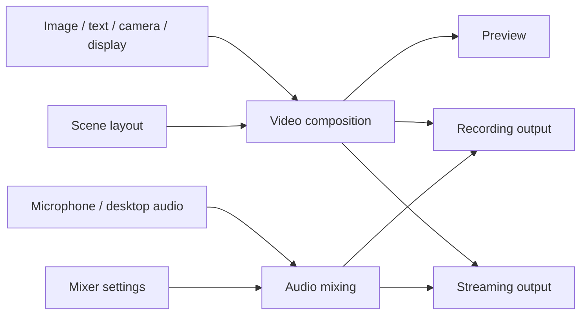
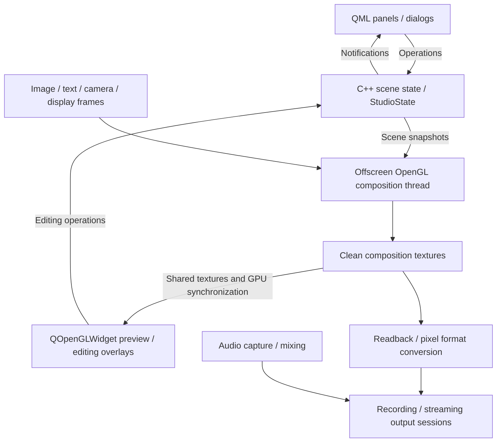

# OpenLive Studio Concepts and Architecture

This document records the agreed concepts and responsibility boundaries. It is
an architectural direction, not a claim that every module exists. Features and
delivery steps remain defined by the [plan](openlive-studio-plan.md) and
[roadmap](openlive-studio-roadmap.md). Collaboration rules remain in
[AGENTS.md](../AGENTS.md).

## Core concepts

| Concept | Responsibility | Example |
| --- | --- | --- |
| Source | Provide video, audio, or both, and manage the resources needed to produce them | An image, camera, display capture, media file or microphone |
| Scene | Describe a composition through source instances and their placement | Desktop background, camera at bottom right, Logo at top left |
| Scene source instance | Reference a source and store placement, layer, visibility and lock state within one scene | The same camera shown at different sizes in two scenes |
| Video composition | Combine source images into the final video frames using the scene layout | Desktop + camera + Logo + text |
| Audio mixing | Combine audio channels using their volume and mute settings | Microphone + desktop sound + background music |
| Mixer panel | Display channel levels and let the user control audio mixing | Level meters, volume sliders and mute buttons |
| Output | Encode and synchronize video and audio for recording or streaming | A playable recording or a live stream |

The source/scene-instance distinction above is a future reuse design, not an MVP
requirement. For the MVP, each scene adds and owns independent source entries.
Adding the same image path to two scenes creates two entries with independent
names, order, visibility, lock flags and later placement/filter properties; it
does not copy the disk file or share application state by path. Removing one
entry leaves the other intact.

Cross-scene source reuse, shared definitions and a reuse UI are deferred beyond
B6. When reuse is introduced, source configuration and media resources can be
shared while placement and editing state remain scene-local. Device ownership
and avoiding repeated opens of the same camera will be addressed with capture
in stage D, without requiring a general reuse framework in B6.

## Source capabilities and scope

Sources can provide video only, audio only, or both. A video file can send frames
to composition and its audio track to mixing. Muting its audio does not hide its
picture. The source list represents scene instances; the mixer represents audio
channels, so their rows do not need to correspond one to one.

The roadmap includes images (B4), text (C6), cameras and displays (D), and
microphone and desktop audio (F). Window capture, application audio and camera
audio are later extensions. Media files are a possible source type, but are not
yet scheduled; this document does not add them to B4. Playback, looping, seeking,
scene-switch behavior and shared playback position require a separate proposal.
Nested scenes remain outside the current project scope.

## Media flow

Composition produces clean video frames; selection borders and resize handles
are preview overlays and must not enter the output. Mixing produces audio.
Timestamps coordinate the two so that, for example, speech matches lip motion.
Audio is not drawn into the video frames.

Recording and streaming consume the same composition and mix, with independent
start/stop state, errors, elapsed time and statistics. Stopping one must not stop
the other. Preview visibility, dock visibility and window minimization must not
control the lifetime of active media processing.

## OpenGL composition and preview architecture

The agreed rendering direction is an independent offscreen OpenGL compositor
with a QOpenGLWidget preview. This is a future implementation decision; the
current preview is still a placeholder. It preserves the Widgets shell and QML
panels without moving media processing into the UI render loop.

### UI and scene state

Widgets own the main window and dock containers. QML owns panel/dialog
presentation and form interaction. QOpenGLWidget owns preview display, editing
overlays and canvas input. It maps mouse coordinates to output-canvas coordinates
and invokes C++ editing operations; it does not keep a second authoritative scene.
Selection outlines and handles are drawn only over the preview.

StudioState and Qt models remain on the GUI thread. Rendering receives snapshots
of the required scene data, including source identity, layer, visibility,
placement and filter parameters as those features are introduced. The worker
must not read or mutate live GUI models. Media resources, rendering resources
and output sessions remain owned by their respective modules.

### Offscreen processing and shared preview

A dedicated processing thread uses QOpenGLContext with QOffscreenSurface to
upload/update source textures, apply per-source filters and compose sources by
placement, size, alpha and layer into output-canvas textures. Qt surface creation
and destruction follow GUI-thread requirements; the processing context is used
only on its owning thread. Context format, sharing and startup/cleanup order
must be specified when this integration is implemented.

The preview uses its own sharing context to display completed composition
textures in paintGL(). Texture sharing does not provide synchronization by
itself: buffered result textures, GPU completion synchronization and consumer
ownership must prevent reading an unfinished frame or reusing a texture while
preview/output still consumes it. A slow or hidden preview may skip frames
without blocking media output. Exact buffer counts and handoff APIs are decided
and tested with implementation.

Composition scheduling and lifetime are independent of paintGL(), window
visibility and UI animation. While outputs are active, minimizing the window or
hiding the preview must not stop composition. The initial output route reads back
clean composition frames and converts their pixel format for encoding; sharing
textures avoids preview readback but does not imply zero-copy encoding.

QQuickWidget panels and QOpenGLWidget in the same top-level window must use a
compatible OpenGL graphics backend. Configure the Qt Quick backend before
creating the first QQuickWidget. Software-rendered UI tests alone do not verify
this integration. See Qt's [graphics API restrictions](https://doc.qt.io/qt-6/qquickwidget.html#graphics-api-support)
and [OpenGL widget threading guidance](https://doc.qt.io/qt-6/qopenglwidget.html#threading).

### Audio, outputs and incremental delivery

Audio capture and mixing run independently of preview rendering. Recording and
streaming consume the same clean composition and mix using a common timing
basis, with independent session state, elapsed time and errors. Whether encoders
can be shared is decided with output implementation; one blocked output must
not indefinitely hold shared buffers or stall the healthy output.

This direction does not require C1 to implement capture, filters, mixing or
encoding in advance. Each implementation proposal defines its files, Qt
dependencies, resource ownership and cleanup, and the subset being delivered.
Graphics acceptance must cover offscreen composition, shared-texture display,
resize/recreation and safe shutdown on a real graphics backend. Continued media
processing while minimized and output isolation are verified when those outputs
exist. Until verified, these remain design requirements rather than completed
capabilities.

## Responsibility boundaries

| Area | Owns |
| --- | --- |
| Widgets / MainWindow | Window and dock containers, menus, layout, native window operations and the shared dialog entry |
| QML | Presentation, interaction and temporary form input; confirmed business state comes from C++ |
| QOpenGLWidget preview | Display completed composition textures, map canvas input to C++ operations, and draw preview-only editing overlays |
| Scene editing / StudioState | Scene content, source references, current scene and source selection, editing rules and list updates |
| Source implementations | Loading or capture, source configuration, media resources, availability and failures |
| Composition and audio processing | Offscreen OpenGL resources and scheduling, frame processing, synchronized result buffers, mixing and audio buffers |
| Outputs | Recording and streaming sessions, encoding/output resources, errors, timing and statistics |
| Application coordination | Operations that span scene data, sources and outputs; object assembly and lifetime coordination as needed |
| Configuration storage | Reading and writing the data required to restore user configuration |

Each module owns its authoritative state. The UI observes that state through
models, properties and notifications and invokes explicit operations. Business
state is not duplicated in Widgets and QML. StudioState is not intended to own
all application state, device handles, media buffers or output sessions.

Simple scene operations can remain direct calls to StudioState. Cross-module
workflows, such as loading an image and then adding its reference to a scene,
belong in application coordination as the need arises. MainWindow remains
focused on UI assembly. These are responsibility boundaries, not a requirement
for one class per row or a single large source manager or controller.

Capture, decoding and encoding work should use suitable execution contexts so
that media work does not block UI interaction. Threading, resource ownership
and cleanup are designed and verified with the feature that introduces them;
the current scene state and Qt models must not be mutated from worker threads.

## Current implementation and next boundaries

B1 through B6 are complete and approved. The application has the Widgets shell,
QML panels/dialogs, scene editing in StudioState, and an independent ImageLoader.
Source descriptions store their type, file path and original image dimensions.
ImageLoader checks and actually decodes files synchronously, returns metadata or
an error, and discards the pixels. StudioState still coordinates that call during
image validation/insertion and owns scene/name rules, selection and list updates.
There is no asynchronous loading, image cache or composition backend yet.

The add form is QML, with only the image type currently available. MainWindow
passes an unused name for the captured target scene and hosts a C++ QFileDialog
for browsing. Picking a file updates the form; confirmation creates the source.
The shared dialog entry no longer forces an early native handle, exposes a
window handle to QML, or manually centers dialogs. Qt handles window placement.
The removal form captures both scene and source IDs, allows removal of the last
source, and never deletes the underlying file. Source-panel add/remove actions
remain connected after QML reload.

The current SourceData structure keeps scene-local source entries and will not
be split into shared sources and scene instances for B6. B5 stores topmost-first
order and per-entry visibility/lock flags
in each scene. StudioState addresses operations by scene/source IDs, exposes
sourceVisible/sourceLocked model roles, and emits row-move or data-change
notifications without resetting the active list. Reordering preserves identity
and selection; row buttons update their own entry without changing selection.
Hidden or locked entries remain selectable, reorderable and removable. QML uses
eye/eye-off and lock/lock-open icons with neutral colors and current-state tooltips;
Widgets retain the existing window and dock containers. States survive scene
changes and QML reloads within the session, but are not persisted across launches.
B6 verifies immediate scene switching, source-list updates, selection clearing
and scene-local state isolation, including entries referring to the same file.
B6 verification is complete and approved: generated-image state tests and
MainWindow interaction/reload tests pass without changes to business code.
It adds no reuse APIs/UI, placement editing or transition animation. Shared
definitions remain deferred. The next step is C1 static-image composition. Transform restrictions and independent placement editing will be
implemented with the editing features in stage C. Actual
composition starts at C1. Cross-module
coordination, media ownership and threading are developed with the relevant
features, rather than building a complete framework in advance. Media-file
playback remains outside the scheduled implementation steps.
