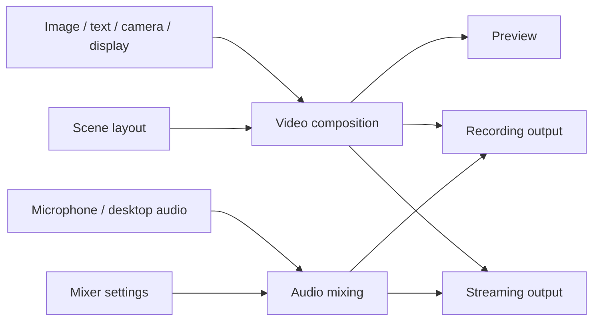
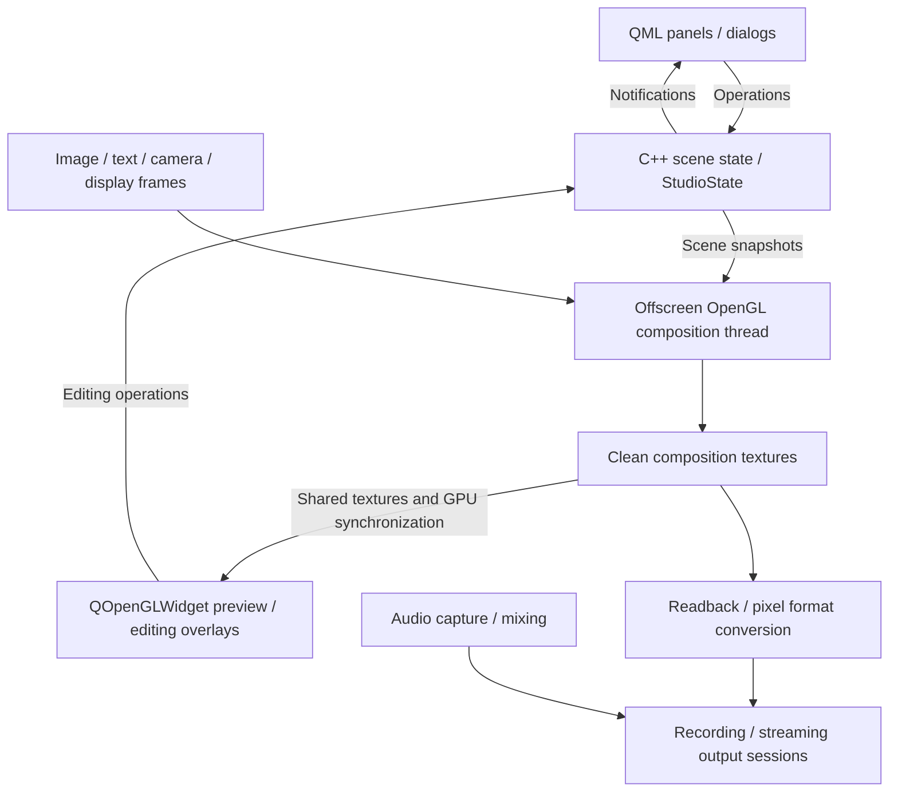

# OpenLive Studio Concepts and Architecture

This document records the agreed concepts and responsibility boundaries. It is
an architectural direction, not a claim that every module exists. Features and
delivery steps remain defined by the [plan](openlive-studio-plan.md) and
[roadmap](openlive-studio-roadmap.md). Collaboration rules remain in
[AGENTS.md](../AGENTS.md).

## Core concepts

| Concept | Responsibility | Example |
| --- | --- | --- |
| Source | Provide video, audio, or both, and manage the resources needed to produce them | An image, camera, display capture, media file or microphone |
| Scene | Describe a composition through source instances and their placement | Desktop background, camera at bottom right, Logo at top left |
| Scene source instance | Reference a source and store placement, layer, visibility and lock state within one scene | The same camera shown at different sizes in two scenes |
| Video composition | Combine source images into the final video frames using the scene layout | Desktop + camera + Logo + text |
| Audio mixing | Combine audio channels using their volume and mute settings | Microphone + desktop sound + background music |
| Mixer panel | Display channel levels and let the user control audio mixing | Level meters, volume sliders and mute buttons |
| Output | Encode and synchronize video and audio for recording or streaming | A playable recording or a live stream |

The source/scene-instance distinction above is a future reuse design, not an MVP
requirement. For the MVP, each scene adds and owns independent source entries.
Adding the same image path to two scenes creates two entries with independent
names, order, visibility, lock flags and later placement/filter properties; it
does not copy the disk file or share application state by path. Removing one
entry leaves the other intact.

Cross-scene source reuse, shared definitions and a reuse UI are deferred beyond
B6. When reuse is introduced, source configuration and media resources can be
shared while placement and editing state remain scene-local. Device ownership
and avoiding repeated opens of the same camera will be addressed with capture
in stage D, without requiring a general reuse framework in B6.

## Source capabilities and scope

Sources can provide video only, audio only, or both. A video file can send frames
to composition and its audio track to mixing. Muting its audio does not hide its
picture. The source list represents scene instances; the mixer represents audio
channels, so their rows do not need to correspond one to one.

The roadmap includes images (B4), text (C6), cameras and displays (D), and
microphone and desktop audio (F). Window capture, application audio and camera
audio are later extensions. Media files are a possible source type, but are not
yet scheduled; this document does not add them to B4. Playback, looping, seeking,
scene-switch behavior and shared playback position require a separate proposal.
Nested scenes remain outside the current project scope.

## Media flow



Composition produces clean video frames; selection borders and resize handles
are preview overlays and must not enter the output. Mixing produces audio.
Timestamps coordinate the two so that, for example, speech matches lip motion.
Audio is not drawn into the video frames.

Recording and streaming consume the same composition and mix, with independent
start/stop state, errors, elapsed time and statistics. Stopping one must not stop
the other. Preview visibility, dock visibility and window minimization must not
control the lifetime of active media processing.

## OpenGL composition and preview architecture

The agreed rendering direction is an independent offscreen OpenGL compositor
with a QOpenGLWidget preview. C1 implements this path for static images through
SceneSnapshotBuilder, CompositionSession, ImageCompositor and PreviewWidget.
Capture, filters, editing interactions, audio and encoding remain future work.
The implementation preserves the Widgets shell and QML panels without moving
media processing into the UI render loop.



### UI and scene state

Widgets own the main window and dock containers. QML owns panel/dialog
presentation and form interaction. QOpenGLWidget currently owns preview display.
Canvas input and selection linkage begin at C2; dragging, resizing and transform
editing follow in C3-C5. Those interactions will map mouse coordinates to the
output canvas and invoke C++ operations, without a second authoritative scene.
Future selection outlines and handles belong only to the preview.

StudioState and Qt models remain on the GUI thread. Rendering receives snapshots
of the required scene data, including source identity, layer, visibility,
placement and filter parameters as those features are introduced. The worker
must not read or mutate live GUI models. Media resources, rendering resources
and output sessions remain owned by their respective modules.

### Offscreen processing and shared preview

A dedicated processing thread uses QOpenGLContext with QOffscreenSurface to
upload/update source textures, apply per-source filters and compose sources by
placement, size, alpha and layer into output-canvas textures. Qt surface creation
and destruction follow GUI-thread requirements; the processing context is used
only on its owning thread. Context format, sharing and startup/cleanup order
are implemented for C1: the GUI thread owns the offscreen surface, while the
composition worker creates, uses and releases its sharing context and FBOs.

The preview uses its own sharing context to display completed composition
textures in paintGL(). Texture sharing does not provide synchronization by
itself: buffered result textures, GPU completion synchronization and consumer
ownership must prevent reading an unfinished frame or reusing a texture while
preview/output still consumes it. A slow or hidden preview may skip frames
without blocking the producer. C1 uses three result slots, latest-only delivery,
producer/consumer GPU fences and explicit frame acquire/return APIs. A slot is
not reused while its lease is outstanding.

Each slot contains two textures: an opaque black-backed output composition and
a premultiplied RGBA preview composition retaining transparency. One frame token
leases both textures; both are checked on return, fenced and released together.
PreviewWidget reads only the preview texture and blends it on the GPU over
`preview.canvas`; `preview.surrounding` colors the area outside the fitted canvas.
ThemeManager owns these JSON colors and MainWindow passes them into the preview.
Theme changes do not recolor genuine black image pixels or alter the output
texture. This costs a second render target and composition pass per slot/frame;
performance has not been benchmarked. Encoding and output consumers are not yet
implemented.

Composition scheduling and lifetime are independent of paintGL(), window
visibility and UI animation. While outputs are active, minimizing the window or
hiding the preview must not stop composition. The initial output route reads back
clean composition frames and converts their pixel format for encoding; sharing
textures avoids preview readback but does not imply zero-copy encoding.

QQuickWidget panels and QOpenGLWidget in the same top-level window must use a
compatible OpenGL graphics backend. Configure the Qt Quick backend before
creating the first QQuickWidget. Software-rendered UI tests alone do not verify
this integration. See Qt's [graphics API restrictions](https://doc.qt.io/qt-6/qquickwidget.html#graphics-api-support)
and [OpenGL widget threading guidance](https://doc.qt.io/qt-6/qopenglwidget.html#threading).

### Audio, outputs and incremental delivery

Audio capture and mixing run independently of preview rendering. Recording and
streaming consume the same clean composition and mix using a common timing
basis, with independent session state, elapsed time and errors. Whether encoders
can be shared is decided with output implementation; one blocked output must
not indefinitely hold shared buffers or stall the healthy output.

This direction does not require C1 to implement capture, filters, mixing or
encoding in advance. Each implementation proposal defines its files, Qt
dependencies, resource ownership and cleanup, and the subset being delivered.
Graphics acceptance must cover offscreen composition, shared-texture display,
resize/recreation and safe shutdown on a real graphics backend. Continued media
processing while minimized and output isolation are verified when those outputs
exist. Until verified, these remain design requirements rather than completed
capabilities.

## Responsibility boundaries

| Area | Owns |
| --- | --- |
| Widgets / MainWindow | Window and dock containers, menus, layout, native window operations and the shared dialog entry |
| QML | Presentation, interaction and temporary form input; confirmed business state comes from C++ |
| QOpenGLWidget preview | Display completed composition textures, map canvas input to C++ operations, and draw preview-only editing overlays |
| Scene editing / StudioState | Scene content, source references, current scene and source selection, editing rules and list updates |
| Source implementations | Loading or capture, source configuration, media resources, availability and failures |
| Composition and audio processing | Offscreen OpenGL resources and scheduling, frame processing, synchronized result buffers, mixing and audio buffers |
| Outputs | Recording and streaming sessions, encoding/output resources, errors, timing and statistics |
| Application coordination | Operations that span scene data, sources and outputs; object assembly and lifetime coordination as needed |
| Configuration storage | Reading and writing the data required to restore user configuration |

Each module owns its authoritative state. The UI observes that state through
models, properties and notifications and invokes explicit operations. Business
state is not duplicated in Widgets and QML. StudioState is not intended to own
all application state, device handles, media buffers or output sessions.

Simple scene operations can remain direct calls to StudioState. Cross-module
workflows, such as loading an image and then adding its reference to a scene,
belong in application coordination as the need arises. MainWindow remains
focused on UI assembly. These are responsibility boundaries, not a requirement
for one class per row or a single large source manager or controller.

Capture, decoding and encoding work should use suitable execution contexts so
that media work does not block UI interaction. Threading, resource ownership
and cleanup are designed and verified with the feature that introduces them;
the current scene state and Qt models must not be mutated from worker threads.

## Threading plan

Plan execution contexts around ownership, blocking operations and shutdown, not
a fixed thread-count requirement. The following is a reference arrangement for
one camera, one display, microphone and desktop audio, with recording and
streaming active together. It is a future design, not the current implementation.

| Execution context | Reference count | Responsibility |
| --- | ---: | --- |
| GUI | 1 | Widgets, QML interaction, StudioState/models, QOpenGLWidget display and canvas input |
| OpenGL composition | 1 | Source texture updates, filters, composition, synchronized result handoff and readback scheduling |
| Camera capture | 1 | Read/decode camera frames as needed, assign timestamps and submit frames |
| Display capture | 1 | Acquire and submit desktop frames |
| Microphone capture | 1 | Acquire microphone audio |
| Desktop audio capture | 1 | Acquire playback-device audio |
| Audio processing/encoding | 1 | Resampling, volume, mute, mixing and audio encoding |
| Video encoding | 1 | Convert submitted composition frames as required and encode video |
| Recording writer | 1 | Interleave encoded packets, write the file and finalize it |
| Streaming writer | 1 | Interleave/send encoded packets, handle network timeout, disconnect and recovery |
| Total reference count | 10 | Includes the GUI thread; excludes library and driver internal threads |

The table assumes compatible output encoding settings for sharing encoded
results. Recording and streaming with different video or audio encoding
requirements may need separate encoding contexts and additional threads. A
capture backend that supplies callbacks may not need a dedicated application
capture thread; callback ownership and lifetime must still be explicit. Qt,
drivers and encoders can create additional internal threads, so the process
thread count is not an acceptance criterion.

### Incremental introduction

| Stage | Execution contexts introduced as needed |
| --- | --- |
| C: static composition | GUI and OpenGL composition: two main application threads; image loading may use temporary tasks |
| D: camera/display | Capture workers or backend callback contexts for the actual devices |
| F: audio | Audio capture and mixing/processing; audio encoding is added with output support |
| G: recording | Video/audio encoding and the recording writer |
| H: streaming | Independent network writer, plus separate encoding contexts if output settings require them |

Do not create one thread per scene, static image, text item, QML panel or
preview widget. GUI interactions stay on the GUI thread. Static loading can use
a bounded task pool when asynchronous loading is introduced. Shared media
processing remains active while any output needs it; stopping one output must
not stop resources still used by the other.

### Handoffs, backpressure and shutdown

Use bounded frame/packet handoffs and define ownership at every boundary.
Capture, composition and preview must not accumulate an unlimited frame history;
where video frames may be skipped, define the policy and account for drops.
Audio handoffs require an explicit continuity and overload policy. Queue sizes,
timestamp rules and overload behavior are specified with each feature, rather
than assuming that adding threads solves throughput problems.

Recording and streaming have independent writer queues and cancellation/error
paths. Slow network I/O must not block file writing or indefinitely retain
shared frames/packets. On normal stop, end that output's input, drain/flush the
required encoding and writing work, and finalize its resources while preserving
other active consumers. Application shutdown must cancel blocking device/network
operations, wake waiting workers and join them before destroying their resources;
GL resource cleanup requires its owning context, and GUI-owned surfaces are
destroyed on the GUI thread. Concrete ordering and failure recovery are verified
when the respective workers are introduced.

## Directory organization

Use responsibility-based directories with moderate layering. The following tree
is the target organization, not an inventory of existing files. Add directories
only when their features are implemented; it does not authorize a repository-wide
move or require empty scaffolding before C1.

```text
OpenLiveStudio/
├── CMakeLists.txt
├── README.md
├── AGENTS.md
├── LICENSE
├── cmake/                       # Dependency discovery and build helpers
├── docs/                        # Plan, architecture, roadmap and prototype
├── assets/
│   ├── icons/                   # Shared SVG assets, provenance and licenses
│   └── shaders/                 # GLSL packaged through Qt resources as needed
│       ├── composition/
│       └── filters/
├── src/
│   ├── app/                     # Entry point, assembly and lifecycle coordination
│   ├── ui/
│   │   ├── widgets/             # MainWindow, docks and native window integration
│   │   ├── qml/                 # Panels, dialogs and reusable QML components
│   │   └── preview/             # QOpenGLWidget, coordinates and editing overlays
│   ├── scene/                   # StudioState, scene/source entry data and models
│   ├── sources/                 # Image loading, text generation, camera/display capture
│   ├── graphics/
│   │   ├── opengl/              # Contexts, textures, FBOs, synchronization and readback
│   │   ├── composition/         # Render snapshots, layout composition and scheduling
│   │   └── filters/             # Per-source filter implementations and processing chain
│   ├── audio/                   # Audio capture, resampling, mixing and levels
│   ├── output/                  # Recording/streaming sessions, encoding and muxing
│   ├── config/                  # Configuration storage and validation
│   └── media/                   # Frame/timestamp types genuinely shared by modules
├── tests/                       # Tests organized by business module as they grow
├── scripts/                     # Build, output validation and packaging helpers
└── third_party/                 # Third-party notices and necessary vendored sources
```

### Placement and dependency boundaries

| Directory | Responsibility and boundary |
| --- | --- |
| scene | Scene content, source entries, selection and editing rules; no OpenGL resources or encoder ownership |
| sources | Supply images/frames and own loading/capture resources; do not decide canvas placement |
| graphics | Filters, composition, GPU resources and synchronized result handoff; no access to QML controls or live GUI list models |
| ui/preview | Display results, editing overlays and input; do not drive continuous composition required by outputs |
| audio | Own audio device capture and processing; source-related audio routing is coordinated as those capabilities arrive |
| output | Own encoding, muxing and independent output sessions; do not obtain video by capturing the preview widget |
| app | Assemble modules and coordinate cross-module operations/shutdown; do not accumulate all business implementations |
| media | Only types actually shared across modules; OpenGL texture handoff types stay in graphics |

Scene snapshots and source frame handoffs form the processing boundary; adding a
directory does not justify adding a generic manager or framework. Encoding and
muxing can stay together in output until their actual complexity calls for
subdirectories. Directory boundaries do not require separate CMake libraries:
start with the existing executable and split build targets when testing or reuse
provides a concrete reason.

Tests may remain flat while small, then follow module responsibilities. Prefer
small controlled fixtures or generated assets; large recordings, benchmark
outputs, build products and dependency binaries do not belong in the source
tree. Preserve third-party provenance and license records beside assets where
applicable; third_party is not a requirement to move the icon notices.

### Existing paths and incremental adoption

The current entry point is src/app/main.cpp, MainWindow is in src/ui/widgets,
QML files are in src/ui/qml, StudioState is in src/scene, and ImageLoader is in
src/sources. Application and test build references follow these paths. QML
resource aliases preserve the existing qrc:/OpenLiveStudio/Ui/qml URLs and the
OpenLiveStudio.Ui module URI. Application and test resources use the same QML
file list. These moves preserve the contents of the C++ and QML files.

Only populated directories have been migrated; media is reserved for shared
media types when needed. C1 should introduce only
the directories needed for its approved composition/preview subset. Capture,
audio, output and configuration directories follow their scheduled features.

## Current implementation and next boundaries

B1 through B6 are complete and approved. The application has the Widgets shell,
QML panels/dialogs, scene editing in StudioState, and an independent ImageLoader.
Source descriptions store their type, file path and original image dimensions.
ImageLoader checks and actually decodes files synchronously, returns metadata or
an error, and discards the pixels. StudioState still coordinates that call during
image validation/insertion and owns scene/name rules, selection and list updates.
SceneSnapshotBuilder separately decodes the current scene on a worker into
immutable, latest-only image snapshots; it skips hidden sources and reports
missing/corrupt files while allowing valid layers to render. CompositionSession
runs ImageCompositor on an independent OpenGL thread and hands shared textures
to PreviewWidget. There is no file watcher or general image-cache framework;
scene/source changes trigger rereads, and an active image decode can delay exit.

The add form is QML, with only the image type currently available. MainWindow
passes an unused name for the captured target scene and hosts a C++ QFileDialog
for browsing. Picking a file updates the form; confirmation creates the source.
The shared dialog entry no longer forces an early native handle, exposes a
window handle to QML, or manually centers dialogs. Qt handles window placement.
The removal form captures both scene and source IDs, allows removal of the last
source, and never deletes the underlying file. Source-panel add/remove actions
remain connected after QML reload.

The current SourceData structure keeps scene-local source entries and will not
be split into shared sources and scene instances for B6. B5 stores topmost-first
order and per-entry visibility/lock flags
in each scene. StudioState addresses operations by scene/source IDs, exposes
sourceVisible/sourceLocked model roles, and emits row-move or data-change
notifications without resetting the active list. Reordering preserves identity
and selection; row buttons update their own entry without changing selection.
Hidden or locked entries remain selectable, reorderable and removable. QML uses
eye/eye-off and lock/lock-open icons with neutral colors and current-state tooltips;
Widgets retain the existing window and dock containers. States survive scene
changes and QML reloads within the session, but are not persisted across launches.
B6 verifies immediate scene switching, source-list updates, selection clearing
and scene-local state isolation, including entries referring to the same file.
B6 verification is complete and approved: generated-image state tests and
MainWindow interaction/reload tests pass without changes to business code.
It adds no reuse APIs/UI, placement editing or transition animation. Shared
definitions remain deferred. C1 static-image composition is complete and
committed: aspect fit, alpha, topmost-first layers, visibility and scene changes
are reflected in the native preview. A8 is also complete: an application-owned
ThemeManager loads semantic JSON colors, shares them with Widgets and QML, and
persists only the dark/light preference. The separate Theme menu handles
exclusive selection and save failures.

The next feature is C2 canvas/list selection linkage; it has not started.
Transform restrictions and independent placement editing remain C3-C5 work.
Cross-module coordination, media ownership and threading continue to evolve with
the relevant features. Media-file playback is outside the scheduled steps.

Local native OpenGL tests have passed on an NVIDIA RTX 4060 Ti / WGL backend,
including alpha preview, context cleanup and Qt Quick coexistence. Intermittent
WGL context-sharing failures remain unresolved; a passing retry is not a fix.
Other drivers, forced context loss, capture devices, recording and streaming
remain unverified. The software UI CTest budget is now 120 seconds; three
consecutive runs passed in 57.27, 115.82 and 118.28 seconds, leaving little
headroom in the latter runs. See the [test record](../tests/README.md) for the
distinction between historical results and current verification limits.
