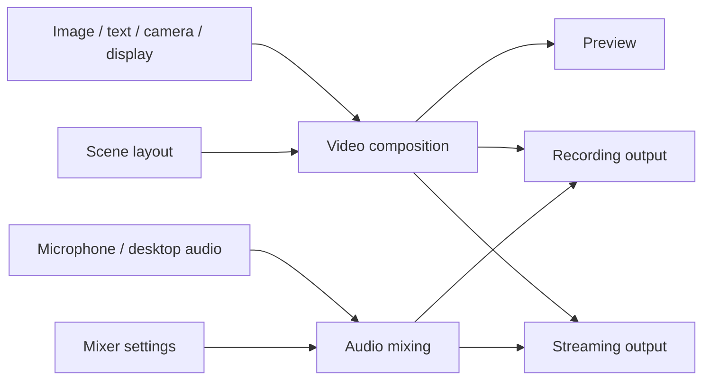

# OpenLive Studio Concepts and Architecture

This document records the agreed concepts and responsibility boundaries. It is
an architectural direction, not a claim that every module exists. Features and
delivery steps remain defined by the [plan](openlive-studio-plan.md) and
[roadmap](openlive-studio-roadmap.md). Collaboration rules remain in
[AGENTS.md](../AGENTS.md).

## Core concepts

| Concept | Responsibility | Example |
| --- | --- | --- |
| Source | Provide video, audio, or both, and manage the resources needed to produce them | An image, camera, display capture, media file or microphone |
| Scene | Describe a composition through source instances and their placement | Desktop background, camera at bottom right, Logo at top left |
| Scene source instance | Reference a source and store placement, layer, visibility and lock state within one scene | The same camera shown at different sizes in two scenes |
| Video composition | Combine source images into the final video frames using the scene layout | Desktop + camera + Logo + text |
| Audio mixing | Combine audio channels using their volume and mute settings | Microphone + desktop sound + background music |
| Mixer panel | Display channel levels and let the user control audio mixing | Level meters, volume sliders and mute buttons |
| Output | Encode and synchronize video and audio for recording or streaming | A playable recording or a live stream |

A source and its placement have different lifetimes and responsibilities. Shared
source configuration, media resources and device capture belong to the source;
position, size, layer, visibility and lock state belong to its scene instance.
Reusing a camera should allow independent placement without opening the same
device again. Concrete ownership and reuse rules will be implemented with B6
and the relevant capture steps.

## Source capabilities and scope

Sources can provide video only, audio only, or both. A video file can send frames
to composition and its audio track to mixing. Muting its audio does not hide its
picture. The source list represents scene instances; the mixer represents audio
channels, so their rows do not need to correspond one to one.

The roadmap includes images (B4), text (C6), cameras and displays (D), and
microphone and desktop audio (F). Window capture, application audio and camera
audio are later extensions. Media files are a possible source type, but are not
yet scheduled; this document does not add them to B4. Playback, looping, seeking,
scene-switch behavior and shared playback position require a separate proposal.
Nested scenes remain outside the current project scope.

## Media flow

Composition produces clean video frames; selection borders and resize handles
are preview overlays and must not enter the output. Mixing produces audio.
Timestamps coordinate the two so that, for example, speech matches lip motion.
Audio is not drawn into the video frames.

Recording and streaming consume the same composition and mix, with independent
start/stop state, errors, elapsed time and statistics. Stopping one must not stop
the other. Preview visibility, dock visibility and window minimization must not
control the lifetime of active media processing.

## Responsibility boundaries

| Area | Owns |
| --- | --- |
| Widgets / MainWindow | Window and dock containers, menus, layout, native window operations and the shared dialog entry |
| QML | Presentation, interaction and temporary form input; confirmed business state comes from C++ |
| Scene editing / StudioState | Scene content, source references, current scene and source selection, editing rules and list updates |
| Source implementations | Loading or capture, source configuration, media resources, availability and failures |
| Composition and audio processing | Rendering resources, frame processing, mixing and processing buffers |
| Outputs | Recording and streaming sessions, encoding/output resources, errors, timing and statistics |
| Application coordination | Operations that span scene data, sources and outputs; object assembly and lifetime coordination as needed |
| Configuration storage | Reading and writing the data required to restore user configuration |

Each module owns its authoritative state. The UI observes that state through
models, properties and notifications and invokes explicit operations. Business
state is not duplicated in Widgets and QML. StudioState is not intended to own
all application state, device handles, media buffers or output sessions.

Simple scene operations can remain direct calls to StudioState. Cross-module
workflows, such as loading an image and then adding its reference to a scene,
belong in application coordination as the need arises. MainWindow remains
focused on UI assembly. These are responsibility boundaries, not a requirement
for one class per row or a single large source manager or controller.

Capture, decoding and encoding work should use suitable execution contexts so
that media work does not block UI interaction. Threading, resource ownership
and cleanup are designed and verified with the feature that introduces them;
the current scene state and Qt models must not be mutated from worker threads.

## Current implementation and next adjustment

The application currently has the Widgets shell, QML panels/dialogs and
StudioState for scene editing. B1 through B3 are complete. B4's first round is
reviewed and committed as `97459a4`: source metadata, image
validation and insertion are present, but no source-add UI or composition is
connected. The current SourceData structure has not yet separated reusable
sources from scene instances.

That first round currently decodes images synchronously inside StudioState.
The agreed architectural direction is to move image reading/decoding into a
focused source-loading component, leaving scene validation and insertion in
StudioState. That adjustment has not been implemented or separately authorized.
It requires a small implementation proposal before changing code. Future modules
are introduced alongside actual features, rather than building a complete media
framework in advance.
